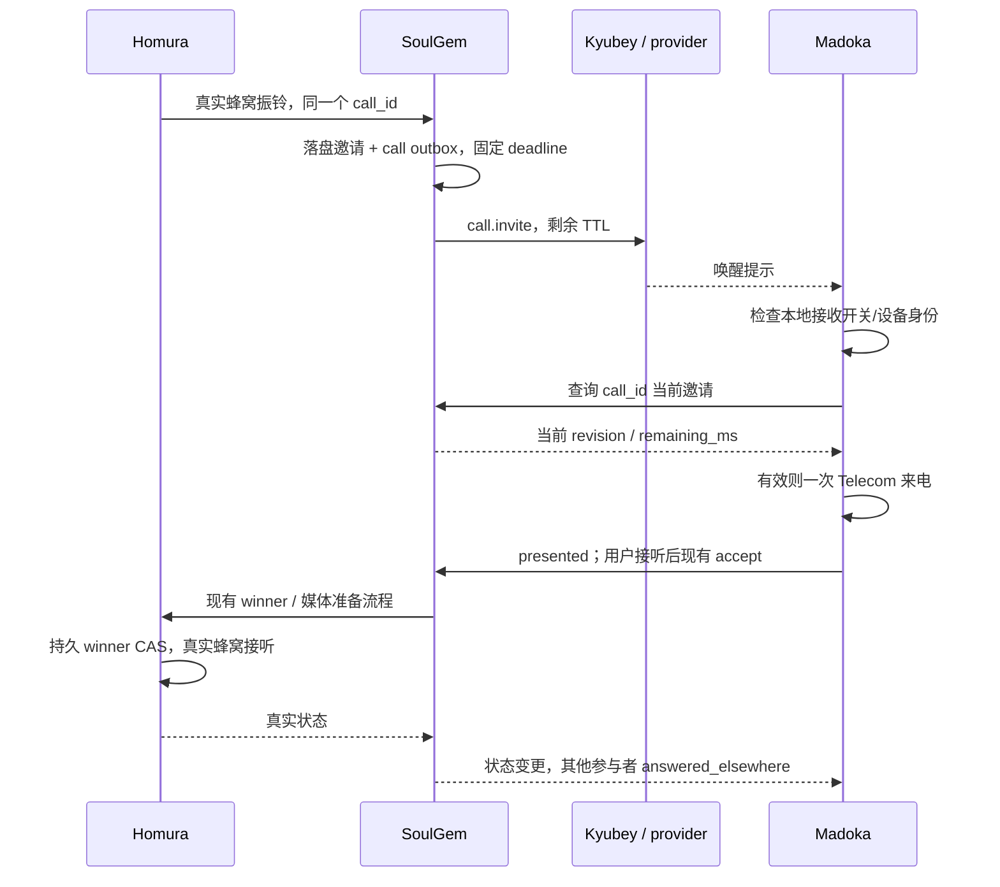

# Reception v2：独立电话订阅、短信同步与按需唤醒

状态：协议提案，尚未实现。配套实施顺序见 [PLAN](reception-v2-PLAN.md)。本提案中的 MUST 表示实现必须满足的约束；所有时间与并发默认值是本项目的初始设计值，不是参考项目的性能承诺。

核对基线（2026-10-27）：Madoka PR #36 `9995d388`；SoulGem main `5a0dab5d`；Homura main `31f65a7d`；Kyubey `28213b59`。服务端基线通过远端 main 源码核对。文档提交基于 Madoka main `09eda0b5`，不包含 PR #36 的应用改动。

本文件先在 Madoka 仓库保存完整设计。实施第一步将规范迁入 SoulGem `docs/reception-v2.md`，与服务端 OpenAPI/fixtures 一起成为唯一协议权威；本文件随后改为固定提交链接。现有 `protocol-pin.md` 在服务端实现可用前不变。

## 1. 已完成的参考与设计选择

以下来源已阅读。借鉴的是移动端接收模型，保留现有 HTTPS 呼叫控制和原生 WebRTC，不重新引入 SIP 引擎。

| 官方来源 | 已核对的实践 | 本项目采用的设计 |
| --- | --- | --- |
| [RFC 8599](https://datatracker.ietf.org/doc/html/rfc8599)，2019，尤其 §4、§5 | 推送唤醒休眠 UA，恢复注册后继续投递请求 | 接收身份与当前连接分离；邀请在服务器等待；不用短在线心跳证明接收资格。RFC 本身仍有注册刷新要求，本提案的持久订阅是我们的选择 |
| [Flexisip PushNotification 当前文档](https://wiki.linphone.org/xwiki/wiki/public/view/Flexisip/Core%20servers/Configuration%20reference%20guide/master/module/PushNotification)，文档注明 `2.7.0-alpha-97-g34521b37`；[2.4.2 文档](https://wiki.linphone.org/xwiki/wiki/public/view/Flexisip/Core%20servers/Configuration%20reference%20guide/2.4.2/module/PushNotification) | 来电与消息使用不同 TTL；可委托 HTTP 中继；移动端不必保持永久连接 | 短期来电邀请、持久短信事实；Kyubey 只负责投递；不让短信积压阻塞电话 |
| [Flexisip 对迟到推送的处理](https://www.linphone.org/en/news/the-end-of-ghost-calls-on-iphone-thanks-to-flexisip-2-2/) | 保留已取消呼叫上下文，处理手机醒来时呼叫已结束的情况 | 客户端先取权威状态再响铃；保留终态，迟到推送不能复活通话。文中的 iOS CallKit 行为不直接移植到 Android |
| [Kamailio TSILO](https://www.kamailio.org/docs/modules/stable/modules/tsilo.html) | 保存事务，在新 contact 出现后追加分支 | 来电事务允许已订阅但暂时断连的设备加入；仍受原截止时间约束。TSILO 内存事务本身不等于我们的持久 outbox |
| [Twilio Voice Android FAQ](https://www.twilio.com/docs/voice/sdks/android/faq)，Incoming Calls / Push notifications | 后台来电使用推送；设备 token 更新时重新登记；推送登记与短期访问令牌不同 | token 换代触发登记，不按分钟刷新接听资格；保持鉴权与推送端点分离 |
| [Android Doze](https://developer.android.com/training/monitoring-device-state/doze-standby)、[FCM 优先级与处理生命周期](https://firebase.google.com/docs/cloud-messaging/android-message-priority) | Doze 限制网络/闹钟；紧急用户可见通知与后台同步不同；异步处理须有受支持的生命周期 | 不用一分钟精确闹钟维持协议；真实来电/新短信通知按平台规则投递；无声探测不用紧急推送 |

这些来源支持架构选择，不证明 Madoka 已达到这些项目的来电成功率或耗电水平。

## 2. 当前约束与替换边界

当前 SoulGem `rtc_control.go` 用最近 90 秒 capability，或最多 30 分钟 `sleep_until` 加有效 push endpoint，决定来电资格。Madoka `RtcSleep.kt` 要求各符合条件节点有授权与近期 push，才能使用十分钟节拍；否则一分钟节拍，部分条件失败回到 `COMPAT_IDLE`。`PushWake.handle()` 对 v1 提示同时调度 CALL/SYNC；`HostBackgroundService` 的 WSS 存活还直接影响电话运行时。

Kyubey基线 `src/relay.js` 只接收 `sms/call/check` 并丢弃其他业务字段；`src/fcm.js` 固定HIGH和60秒TTL。因此仅改变SoulGem请求正文不足以实现短邀请TTL、call_id或领域回执，P4必须先落地再启用完整v2。

Reception v2 替换**空闲接收、邀请投递、事件同步和后台资源归属**。现有配对、SIM 映射校验、RTC 操作幂等、20 秒活动呼叫控制租约、Homura winner CAS、真实蜂窝执行账本与 ICE/DTLS-SRTP/Opus 保留。空闲订阅不是活动呼叫租约。

第一版不依赖 mesh 完成，不实现跨节点通话无缝迁移。节点间尚未建立授权转发时，不能假设手机连接 A 就能接到仅存在 B 上的来电或短信。

## 3. 不可破坏的约束

1. 已配对且 `calls.incoming.enabled=true` 的设备不因休眠、连接断开、近期没有 push 或 capability 过期而失去订阅资格。订阅有效不代表保证可达。
2. `sms.sync.enabled` 与 `calls.incoming.enabled` 独立保存、授权、投递、执行和诊断；一个领域失败不能停掉另一个。共享认证与网络连接可以复用。
3. 关闭来电监听不注销短信端点、不清短信 cursor、不停止已有通话、不禁止主动拨号、不启动全局挂断。通话历史同步也不等于监听。
4. 每次来电有固定 deadline；收到 push、重新连接、重复上报不得延长。过期邀请、已接听或已结束的通话不能重新响铃。
5. 投递语义为至少一次；重复消息和操作由持久 ID 去重。不承诺端到端 exactly-once，蜂窝执行仍由 Homura 账本约束。
6. 空闲无常驻 CPU 锁、无为续订而设的精确闹钟、无“探测失败就无限持锁”回退。活跃振铃、通话与有限网络工作单独计量。
7. 推送受理、设备收到、状态拉取、实际响铃、接听成功是不同事实，不用一个 `push_ready` 混在一起。

## 4. 身份与数据模型

`authority_id` 是已配对服务端的稳定身份，不能用收到的 push URL 建连接；`device_id` 是该 authority 下已认证设备。`installation_id` 用于已授权多节点安装关联，本身不构成权限。未来 federation 映射通过显式授权建立。

| 对象 | 主键/版本 | 持久语义 |
| --- | --- | --- |
| reception subscription | `(owner_id, device_id, topic)`；服务端 `revision` | topic 为 `calls.incoming`、`sms.sync`、`calls.history`；独立启停和路由偏好，关闭也保留记录 |
| delivery endpoint | `(device_id, endpoint_id)`；单调 `generation` | token/relay endpoint、支持的投递类别、状态；多个 topic 引用同一端点，停电话不删除端点 |
| incoming invitation | `(call_id, recipient_device_id)`；`revision` | `offered/ringing/withdrawn/expired/answered_elsewhere/ended`；绑定创建时订阅 revision 和固定 deadline |
| wake job | `(authority_id, device_id, topic, wake_id)` | 事务 outbox；端点换代产生新 attempt，业务 wake_id 不变 |
| sync event | `(authority_id, topic, event_id)`；opaque cursor | 分 topic 连续可重放日志；节点 cursor 不可跨 authority 使用 |
| operation | `(actor, operation_id)` 与 payload hash | 沿用现有幂等、会话权限和 SIM 校验；重复同内容返回原结果，异内容冲突 |

`calls.history` 是可延迟同步的通话记录，不携带实时响铃命令。短信正文与收发执行结果继续保存在已有业务表。订阅只决定手机投递，不控制 Homura 是否采集短信，也不删除服务端历史。

订阅不设置 90 秒/30 分钟在线有效期，持续到显式关闭、解绑或授权撤销。端点收到可信永久失效响应时仅失效该 generation；临时网络失败只影响路由健康。可按明确保留政策清理长期废弃安装，但不以定时唤醒手机为清理前提。

访问 token 过期与设备授权撤销分开：手机被唤醒后可走现有合法 refresh；推送只携带不透明信息。设备撤销立即禁用该设备全部订阅与待投递 job，旧 refresh 不可恢复。

## 5. API 与版本协商

新接收协议使用 `/v2`；现有 `/v1/rtc/control/*`、媒体与短信提交接口保持原版本。`GET /v1/capabilities` 新增：

```json
{
  "reception": {
    "versions": [2],
    "subscription_topics": ["calls.incoming", "sms.sync", "calls.history"],
    "wake_versions": [2],
    "call_invite_ttl_ms": 25000,
    "sync_retention_seconds": 2592000
  }
}
```

| API | 请求/响应要点 |
| --- | --- |
| `GET /v2/reception/subscriptions` | 返回当前设备各 topic 的状态、revision、路由模式；不刷新在线资格 |
| `PUT /v2/reception/subscriptions/{topic}` | `operation_id, expected_revision, enabled, delivery_mode`；返回 revision、应用状态、`server_time`。创建用 revision=0 |
| `PUT /v2/reception/endpoints/{endpoint_id}` | `operation_id, expected_generation, provider, endpoint, supported_wake_versions`；返回新 generation；只在创建、token/凭证变化或明确失效恢复时写 |
| `DELETE /v2/reception/endpoints/{endpoint_id}` | generation 前置条件；仅移除指定端点，不能隐式关闭短信或电话订阅 |
| `GET /v2/call-invitations?cursor=...` | 仅当前设备邀请增量/终态，返回 next_cursor、server_time；启动/重连补查，不作空闲定时轮询 |
| `POST /v2/gateway/incoming-calls` | 仅Homura角色；沿用v1 incoming身份、SIM/映射、operation_id、call_id字段，新增observed_at/expires_at；落盘同一RTC call及invitation，返回delivery_status、权威deadline与现有控制定位 |
| `GET /v2/call-invitations/{call_id}` | 返回当前邀请、call revision、原 deadline、`remaining_ms`、已有 RTC 控制定位；无权限 404；未知/已清理不能响铃 |
| `POST /v2/call-invitations/{call_id}/receipts` | `operation_id, invitation_revision, subscription_revision, stage`；stage 为 `received/fetched/presented/suppressed`，不是接听操作 |
| `GET /v2/sync/{topic}?cursor=...&limit=...` | 仅 `sms.sync/calls.history`；事务写入本地缓存、去重和通知日志后再提交 cursor；limit 默认100、上限500 |
| `POST /v2/sync/{topic}/receipts` | 已持久化 checkpoint；不是已读、短信已发送或通知已展示 |
| `POST /v2/wake-receipts` | wake_id、endpoint generation、实际 provider priority、received/fetched/suppressed；可与后续同步批量上传 |
| `WSS /v2/reception/stream` | 鉴权后订阅 topic 与各 cursor；携带分类 hint/变更 revision，权威数据仍经 HTTPS 获取 |
| `POST /v2/reception/migrations` | `operation_id, expected_protocol, target_protocol, subscriptions`；同事务切每设备协议；仅允许本设备迁移，活跃call期间返回409 `CALL_IN_PROGRESS` |
| `POST /v2/sync/bootstrap` | `operation_id, legacy_cursor`；返回绑定authority/device的各topic checkpoint与snapshot token；旧cursor无法映射时要求快照，不能猜测水位 |
| `GET /v2/sync/{topic}/snapshot?token=...&page=...` | token绑定稳定快照、用户和topic，返回分页及快照结束checkpoint；token过期返回410后重新bootstrap；token有效期默认24小时 |

通用错误：401 refresh/reauth；403 已撤销或无权限；409 revision/generation 或幂等内容冲突；410 `CURSOR_EXPIRED`；429 限流并返回 Retry-After。冲突必须重取状态后以**最新本地意图**重算，不能盲目重放旧 enabled=true。503 不得修改订阅。

WSS首帧为 `{"type":"subscribe","topics":["sms.sync"],"cursors":{"sms.sync":"opaque"}}`，topic集合受订阅和权限交集限制。服务端帧为 `{"type":"hint","topic":"sms.sync","wake_id":"uuid","revision":18}` 或 `{"type":"resync_required","topic":"sms.sync"}`；call hint另带call_id与deadline，使用Wake v2相同语义。cursor失效后逐topic补齐，不中断其他topic。帧仅为提示，只有HTTPS增量落盘才能推进cursor；断线重连必须补查，不能假设WSS无丢帧。慢消费者超过有界缓冲时发送resync_required并关闭连接，不无限缓存。

call invitation增量cursor超窗也返回410；客户端重新取当前有效邀请快照并另补calls.history。任何历史条目不直接触发响铃。所有响应的剩余时间使用服务端计算值；客户端以响应接收时的单调时钟计时，并扣除本次请求耗时作保守预算，不用手机可修改的墙钟延长邀请。

不带cursor的邀请GET返回当前有效集合及对应checkpoint。Homura的新incoming入口与v1共享底层call/operation账本，并按服务端能力选用；v1请求/响应形状不变。服务器固定首次接受的起点与最早有效deadline；校验expires_at不晚于observed_at+25秒，并限制允许的设备时钟偏差（初值5秒，超过则拒绝该实时上报并报告时钟异常），不信任重试请求携带的新起点。

关闭电话示例：

```json
{
  "operation_id": "f15e0b69-2a5f-4a34-a012-7a976d24d2b1",
  "expected_revision": 12,
  "enabled": false,
  "delivery_mode": "auto"
}
```

服务器在同一事务提交 revision=13、撤回该设备未接听邀请、取消其 call wake job，再返回成功；短信订阅 revision 和 cursor 不变。已被 provider 接受的通知不能撤回，由手机持久关闭状态拦截。

## 6. 关闭/恢复电话监听的精确定义

用户入口名称为“接收来电”，不称“关闭电话功能”。第一版先实现完整状态和可调用接口；正式开关可在后续版本展示。

| 场景 | 必须发生的行为 |
| --- | --- |
| 在线关闭 | 先原子写本地 desired=false、递增本地 intent sequence，再停新邀请接入/振铃；提交各节点关闭，UI 分别显示本机已关闭与远端同步状态 |
| 离线关闭 | 本机立即不响铃；持久队列保存最新关闭意图；重启、短信 push、网络恢复都不能恢复监听。远端可能仍发送不透明 call push，手机不启动 RTC；恢复后提交关闭 |
| 关闭与 accept 同时发生 | 本地串行 coordinator 决定顺序；服务器对同一参与者的 accept 与关闭使用同一事务锁顺序。accept 先成功则作为已有通话继续；关闭先成功则拒绝 accept |
| 振铃时关闭 | 撤回本设备未接听参与资格、移除 Telecom 来电；其他设备继续振铃。已有候选接听流程按上一行线性化结果处理 |
| 通话中关闭 | 当前媒体和控制租约继续；结束后不接下一通，不再运行空闲 RTC |
| 关闭后主动拨出 | 临时建立这通呼出的 RTC/媒体/控制租约；不写 incoming=true；结束后释放全部电话后台资源 |
| 重新开启 | 网络成功提交 enabled=true 后标为已同步；只接收此 revision 之后创建的新邀请，不重放关闭期间的历史来电 |
| 关闭—开启—关闭快速操作 | 客户端持久串行 mutation 队列可合并未发送项；已发送请求以 operation_id 查清结果。每次响应与本地 intent sequence 比较，旧响应不能改写新意图 |
| 备份恢复/重新配对 | 不把端点/token/session 从备份复活；新设备重新授权接收偏好；已有设备升级保留当前明确选择，打开设置页不能自动启用 |

本地全局开关覆盖当前 Madoka 安装的所有配对；服务器仍按 authority/device 保存。某节点离线显示“该节点设置待同步”，本机关闭始终优先。短信开启不会调用 `CallPreferences.ensureEnabled` 一类自动启用逻辑。

## 7. 来电生命周期



1. 新来电选取有效订阅与授权，不检查 Madoka 最近90秒在线。暂时无投递路由也持久保存邀请；返回 Homura `accepted_for_delivery` 或 `no_subscribers`，不能伪称已响铃。没有订阅时允许 Homura 保持原蜂窝振铃并上报最终未接记录，不自动接听。
2. deadline 初值仍为真实来电起点后25秒，且不得晚于蜂窝已结束。Homura 跨节点重试保留同一 ID/起点；服务器不可每次重置25秒。时间偏差不确定时采用保守剩余时间，不增加窗口。
3. 已有在线 WSS 可先发送邀请 hint，最多等待500ms设备 fetched 回执；未确认立即发 push。无在线连接立即 push，不先全节点探测。WSS 与 push 同到允许重复。
4. 手机使用短工作锁获取鉴权状态；校验 local enabled、subscription revision、recipient、deadline、terminal 后才创建 Telecom。`presented` 只在本地实际接受来电展示后报告，权限受限报告 suppressed。
5. 服务器 received/fetched/presented 只记录投递阶段。接听仍通过现有 accept → 准备媒体 → Homura winner CAS；不把 HTTP ACK、push receipt 或 ICE connected 当真实蜂窝 ACTIVE。
6. 取消、超时、其他设备接听立即持久 terminal；对已触达设备发取消 hint，客户端有限振铃期限也自行结束。客户端处理 push 的 call_id 必须查当前状态，不能按过期 invite 内容响铃。
7. 有效邀请终态至少保留30天（与本版同步窗口相同）；更久清理后返回不存在，仍不响铃。状态 revision 单调；手机建立并持久保存每通 Telecom 去重记录，重启不重新响已终止来电。
8. 振铃/通话期间允许有界快速控制，沿用20秒活动租约。可先保留现有750ms活跃轮询，后续用事件流加5秒活动 lease renewal，只有该方案独立验收后再换；空闲协议升级不顺便改变媒体安全语义。

## 8. 短信与历史同步

短信是一条持久业务事实。Homura 采集、服务端落盘、手机同步、通知展示、用户已读、出站执行/送达是不同阶段；电话监听开关不得更改任何阶段。

- `sms.sync` feed 收录入站短信、出站状态、删除 tombstone 和必要 SIM 引用。`calls.history` feed 仅收录记录变化。SIM 资料可以按 revision 被动拉取，不触发电话引擎。
- 每个 authority/topic 独立 cursor。关闭电话不推进、删除或重置任何短信 cursor；某节点 cursor 不能传给另一节点。
- cursor 默认保留30天；超窗返回410，客户端以 snapshot token 获取稳定分页快照及其水位，再从该水位补增量。后台修复/首次历史不逐条通知；新实时短信按现有稳定 message_id 和通知日志去重。
- 收到 `sms.available` 只调度 SmsSync；收到 `history.available` 只调度历史同步。两者不得启动 `RtcCallEngine`、Telecom、WebRTC 或 capability 续约。
- 短信 hint 可以按 `(authority, recipient, sms.sync)` 合并，cursor 是提示，必须继续拉到服务端返回的完整水位。不能先拿最大 cursor 覆盖中间缺口。
- 紧急、用户可见的新短信通知可以使用符合 provider 规则的即时投递；已读、发送状态、历史补齐和后台检查使用普通投递。OTP 是否及时到达与普通状态同步分开记录；不把所有短信一律延迟。
- 出站继续使用原全局 message_id、payload hash、mapping_revision 和 Homura 持久执行账本；网络超时不生成新 ID、不造成重复发短信。关闭 incoming 不影响显式发送。
- push 丢失后在前台、网络恢复、正常系统调度的 WorkManager 补同步，目标周期可设15分钟并允许系统延后；这是最终补齐途径，不承诺15分钟内送达，也不用于来电唤醒。

## 9. Wake v2 与 Kyubey

消息的领域必须明确，不能再使用一个 call hint 同时推进 call/SMS 水位。

```json
{
  "version": 2,
  "wake_id": "81028252-0c3a-4493-84e1-4e0faf376457",
  "authority_id": "paired-authority-uuid",
  "recipient_device_id": "paired-device-uuid",
  "endpoint_generation": 4,
  "topic": "calls.incoming",
  "kind": "call.invite",
  "object_id": "call-uuid",
  "revision": 3,
  "subscription_revision": 12,
  "expires_at": "2026-10-27T16:00:25Z"
}
```

合法 kind 为 `call.invite/call.cancel/sms.available/history.available/endpoint.check`。phone number、短信正文、access/refresh token、SDP、任意回调 URL 不得进入 push。应用只对本地已配对 authority 取数据；push 是不可信 hint，不能直接授权响铃/接听。端点是发送能力，服务端加密存储；日志不输出端点或 token。

Kyubey当前是无数据库的密封token中继。首版保留这一边界：新增 `POST /v2/register` 接收FCM token及支持版本，返回密封v2 endpoint；`POST /v2/w/{sealed}` 接收上述envelope，验证密封真实性、schema、kind、大小和deadline，透传authority/recipient/generation供手机校验。authority和设备授权由已配对SoulGem及Madoka验证，中继不能仅凭发送方字段证明它。`endpoint_generation` 的新旧权威在SoulGem与Madoka，Kyubey不能假装知道全局当前generation。

解绑/换代后SoulGem停止旧endpoint的任务，Madoka拒绝旧身份或generation提示；provider已经接受的消息仍可能到达。无状态Kyubey不承诺使已泄露的旧密封URL立即不可用；若后续需要中继级即时撤销，须增加明确的端点撤销存储与鉴权，不能靠最终一致去重缓存充当此能力。保留现有token校验 `check`，用户触发的真实端到端测试另用有限TTL的endpoint.check，普通投递且不强行唤醒Doze。

| 项目 | 来电 | 短信/历史 |
| --- | --- | --- |
| 过期 | provider TTL=min(配置上限, call剩余窗口)；不足3秒不再尝试新投递 | 短信提示 TTL 默认24小时；提示过期不删除短信事实；历史使用普通类别 |
| 优先级 | 真实来电使用 provider 对用户可见实时事件的类别；取消沿已建立通道/合适通知更新机制 | 新短信通知可即时；静默同步普通优先级 |
| collapse | 不同 call_id 禁止合并；invite/cancel 允许重复并以权威 revision 收敛 | 同 recipient/topic 的“有新数据”可以合并 |
| 重试 | 单请求超时≤min(3秒,剩余窗口减3秒)；初次+最多2次重投，抖动退避约1/3秒；终态/过期即停 | 独立队列，指数退避上限5分钟，24小时后停止 hint 重投，数据仍可拉取 |
| 并发 | 保留独立实时 worker 配额；每设备/通话有界，单坏端点不阻塞他人 | 单独 worker 与公平调度，不占满 call 配额 |

本版 Kyubey provider adapter 可以继续使用现有 FCM HTTP v1；Android data 值按要求序列化为字符串，TTL 必须写入 provider 实际消息配置。业务 schema 不绑定某个 provider 的 high/normal 字段；后续平台 API 迁移只改适配层。取消不能用周期性紧急静默消息维持信誉；频繁无通知的探测不使用来电类别。

outbox 与业务状态同一数据库事务提交。worker 短事务领取 claim lease，网络 I/O 在事务外；每次重投复查 topic enabled、subscription revision、endpoint generation、deadline、terminal。受理结果只更新该 wake job，不能推进 SMS feed 或标记已响铃。

`queued → provider_accepted → received → fetched → presented` 独立时间戳；失败与 suppressed 有原因。provider 响应丢失允许重投；receipt 丢失不证明设备没收到，重投上限仍生效。端点轮换时尚有效业务生成当前 generation 的 attempt，旧回执不能覆盖新端点健康。

## 10. Android 运行时与无 FCM 降级

| 组件 | 生命周期与责任 |
| --- | --- |
| ReceptionPreferences | 持久本地意图、同步 revision、待提交 mutation；唯一开关权威 |
| ReceptionCoordinator | 按 topic 分发；核对身份/epoch；进程启动先加载本地关闭状态 |
| CallInvitationReceiver | 只处理有效新邀请和取消；需要时创建 CallSession，平时无 RTC engine |
| CallSession | 单通呼叫的控制租约、媒体、Telecom；终态释放；不拥有短信服务 |
| SmsSync / CallHistorySync | 独立有界工作、cursor、去重和重试；复用 HTTP/auth，不依赖 CallRuntime |
| WakeTransport | FCM/其他 provider、按需 WSS；通过 topic demand 集合管理连接；引用数为0才关闭 |
| DeliveryRegistration | 端点生命周期；电话关闭仅移除 topic 需求；短信仍用同一端点 |

三种电话投递模式：`auto`（有合格系统推送时按需唤醒，否则进入 stream 降级）、`stream`（用户选择持续连接的尽力接收）、`foreground`（仅使用中接收）。`enabled=false` 高于全部模式。短信使用自己的投递策略，不随电话模式切换。

有系统推送时，后台空闲关闭仅为来电保留的 WSS，停止 RTC 空轮询、睡眠授权续约、每小时自测；能力配置缓存到版本变更/明确失效/前台恢复。不以“最近两小时没消息”判定推送坏掉。用户主动诊断可以测试，但不改变长期接收权限。

无 FCM/无可用系统唤醒时：

1. 使用一条共享 WSS 服务同一 authority 的所需 topic，CPU 空闲不持锁；没有联邦转发的不同 authority 可能需要各自连接，UI/诊断必须列出真实连接数，不能假称已单连接全网接收。
2. 心跳以维持连接所需最小频率为目标，起始120秒、成功后最多逐步到300秒、实际 idle timeout 证据下降到60秒；非唤醒调度，系统睡眠可延迟。ping/pong 由单侧负责，不叠加双向独立心跳与HTTP空轮询。
3. Wi-Fi/移动/VPN 的有效路径变化合并去抖约2秒后重连；纯信号强弱/无关 capability 回调不直接重建连接。重连指数退避1秒到5分钟、抖动并单实例合并；收到真实业务失败可触发一次恢复。
4. 断流重连携带各 topic cursor，补有效邀请和数据；没有流时不额外每3秒全节点拉 calls。后台恢复受系统调度限制，精确闹钟不作为保障。
5. FGS 仅在用户选择持续连接且符合目标 Android 类型/启动条件时运行；不假设 FGS 等于 CPU 常醒或能绕过 Doze。推送接力使用短工作锁+受支持 job/通话生命周期，不能仅启动裸线程。
6. 系统推送实际优先级降低或无法启动合法后台工作时，记录受限并在合法生命周期补查，不用无限重试保活。无系统唤醒的 Doze 下不保证秒级来电，提示该限制；可以换合适的推送 provider，不能用 mesh 承诺消除手机端限制。

工作锁初值10秒，跨线程 handoff 所有者独立、到期不自动续命；超过预算由任务失败/重试收敛。正在振铃和通话按其业务 deadline/lease 有独立所有者。手机空闲时不得出现 `rtc-compat-idle` 所有者。

## 11. 多节点与 Homura 的边界

第一版对每个已配对 authority 单独订阅，跨节点相同 Homura call_id/message_id 复用已有业务去重；node-specific cursor/participant ID 不能直接混用。有效 push 到达某节点时优先读取该 origin，不先切全局 active node、探测全部节点。活跃通话固定原控制节点。

当前已订阅但无推送的 B 节点不能阻止有推送 A 的接收器休眠；B 的 stream 成本单独计量。A/B 同时投递用同一 Homura call_id 聚合成一次 Telecom；接听仍由 Homura 安装范围 winner CAS 决定。

未来 mesh 可增加 `federation_id, origin_node_id, authority_epoch` 与受限 ingress delegation：手机一条入口连接代理多个授权 origin，服务器复制订阅/取消事实与 wake outbox。只有路径和授权已经存在时才合并入口；尚未复制的消息无法靠故障切换补救。具体 mesh 实施仍遵循服务端独立远期计划，不是本版前置条件。

Homura 本次只调整 incoming eligibility 返回处理、全局起点/deadline、无订阅时真实未接上报、跨节点终态；不修改短信采集服务的启停，不改变拨号/接听副作用去重。手机号、SIM映射修订、占用槽和真实蜂窝 END 仍由现有协议校验。

## 12. 兼容、上线和回退约定

协商分别按 authority 与设备执行：未宣告 v2 的服务器走明确标识的 v1 adapter；v2 server 同时服务旧设备。一个旧节点不能使所有新节点恢复旧轮询。v2 设备开启 incoming 后，server 不再看它的 v1 last_seen/sleep_until；旧 capability 写入不能覆盖其 v2 关闭意图。

每设备保存 `reception_protocol=1|2`。切换到2必须在同一事务迁移现有显式偏好并启用 v2 路由，防止双投递；HTTP响应丢失由同 operation_id 查询/重试确认。新客户端默认不启用全部领域，应继承本机现有状态；全新配对先让用户确认接收意图。endpoint 只有声明 wake v2 才发送 v2，Kyubey未升级就停在兼容路径，不声称已完成 v2 省电。

迁移短信 cursor：在服务端同一一致性快照取得旧 feed 水位与新 topic 起始 checkpoint；客户端通过一次 bootstrap 取得映射，先事务保存再切读源。既有本地 message_id/通知日志继续使用，迁移不得重播历史提醒或丢掉切换间的新短信。

回退是每设备显式事务，保留 enabled=false 和撤销 tombstone；v1 adapter 只在用户仍请求来电时恢复 capability。旧客户端不能理解新的关闭持久语义时，服务端应拒绝其隐式重新启用并要求显式重新授权。数据库采用增量迁移，业务历史、订阅关闭记录、幂等账本不能随开关删除。现有活跃 call 完成后才切换接收协议。
